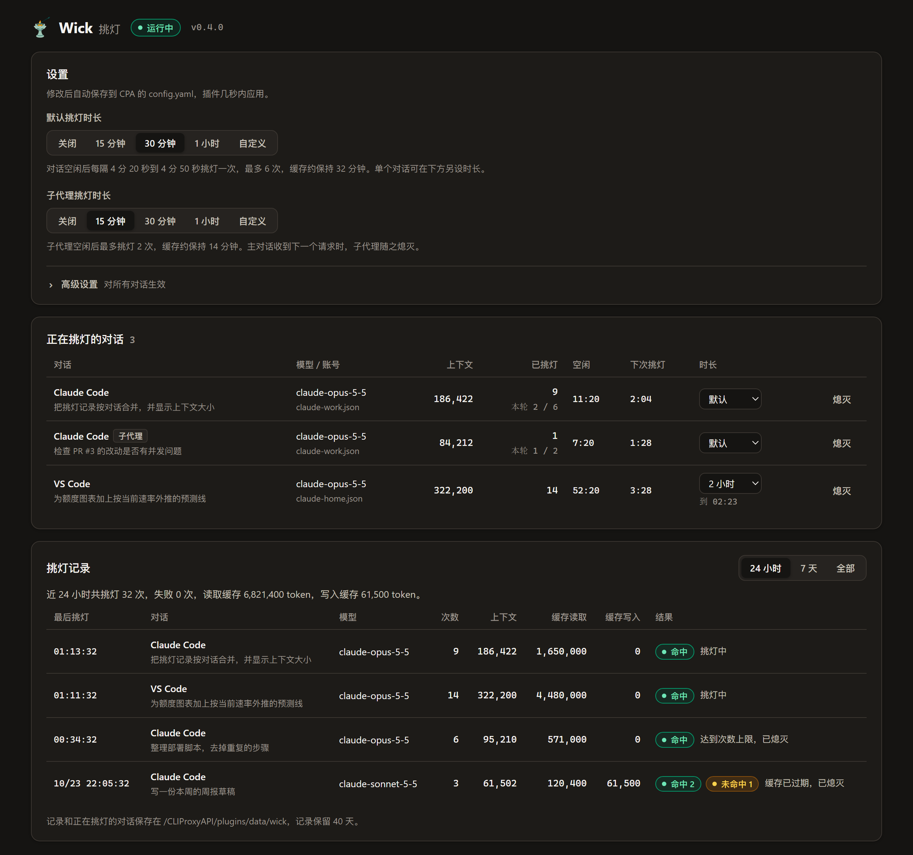

<p align="center"></p>

# Wick

[English](./README_EN.md)

> 醉里挑灯看剑，梦回吹角连营——辛弃疾
>
> 油灯点久了，火光渐弱，用簪子轻轻拨一下灯芯，火焰又亮起来，这就是“挑灯”。Wick 做的也是这样一个轻微的动作：对话空闲、缓存快要过期时，把上一个请求重发一次，缓存就继续有效。
>
> - [Lamplighter](https://github.com/PosvdM/cpa-plugin-lamplighter)（点灯人）：按时点亮下一个额度窗口
> - Wick（挑灯）：守着正在进行的对话，不让灯熄灭

Wick（挑灯）是 [CLIProxyAPI](https://github.com/router-for-me/CLIProxyAPI)（CPA）的原生插件。原生 Claude Code 经 CPA 的 Claude Messages 接口使用 Claude 订阅账号时，Wick 在对话空闲期间定时读取一次 5 分钟提示缓存，回到对话时仍能命中原来的缓存。pi 等其他客户端的挑灯默认关闭，兼容条件见[客户端限制](#客户端限制)。每一次读取称为“挑灯”，停止挑灯称为“熄灭”。



## 功能

- **保持缓存**：对话空闲后每隔 4 分 20 秒到 4 分 50 秒挑灯一次，默认把缓存保持到空闲 30 分钟。默认时长可选 15 分钟、30 分钟、1 小时或自定义分钟数；子代理单独设置，默认 15 分钟，也可以关闭；单个对话可另设时长，最长 24 小时。
- **不改变对话**：挑灯原样重发对话的最后一个请求，收到第一个事件后立即断开。结果不会回到客户端，对话的上下文保持不变。
- **自动熄灭**：到达时长、挑灯请求失败、读不到缓存或发生缓存写入时停止挑灯，避免反复支付未缓存输入或缓存写入费用。对话中途换了工具、系统提示或模型时，原来的缓存不再可用，旧的挑灯随之熄灭。
- **核算省耗**：按 Anthropic 官方定价页的 API 价格，计算每一轮挑灯的花费和你及时回到对话时省下的缓存写入费用，并与不挑灯、改用 1 小时缓存的花费对比。价格每天自动更新，新模型无需升级插件。
- **管理页面**：在 CPA 管理中心查看正在挑灯的对话及其上下文大小、本轮次数和倒计时，对比不同做法的缓存花费，按对话和轮次查看挑灯记录，并修改设置。
- **重启后恢复**：正在挑灯的对话保存在磁盘上，CPA 重启或插件重新加载后按原计划继续。

## 用途

Claude 的提示缓存有两种有效期：5 分钟的写入价是输入价的 1.25 倍，1 小时的是 2 倍；读取缓存只需 0.1 倍。每次读取都会让缓存重新计时。原生 Claude Code 默认使用 5 分钟缓存，离开超过 5 分钟后，下一条消息要按 1.25 倍重新写入整个上下文。上下文有几十万 token 时，这一次重写会消耗明显的额度。

Wick 让平时的写入继续按 5 分钟的价格计算，只在对话空闲时读取缓存。挑灯的读取量同样计入订阅额度：每次挑灯按 0.1 倍读取整个上下文，如果离开的时间短于一两次挑灯的间隔，节省的额度较少。

## 工作方式

- Wick 记录每个对话的最后一个请求。从这个请求开始计时，在 `interval_min` 到 `interval_max` 秒之间随机选一个时刻，把这个请求原样再发一次，收到第一个事件 `message_start` 后立即断开，相当于发出请求后马上按 Esc。收到 `message_start` 时缓存已经读完，有效期随之重新计算；断开前上游可能已生成几个 token。
- 挑灯请求经过 CPA 的模型执行器，使用原请求的账号、请求头和调用方身份，CPA 因此生成和原请求相同的工具名。能否命中原缓存还取决于[客户端限制](#客户端限制)中的条件。
- 挑灯持续到缓存能保持到最后一个请求之后 `duration_minutes` 分钟为止，子代理是 `subagent_duration_minutes`；单个对话可在管理页面另设时长。对话中出现新请求时，计时从新请求开始，开始新的一轮：本轮次数清零，单独设置的时长恢复为默认时长。
- 以下情况熄灭：缓存已能保持到时长结束；挑灯请求失败；挑灯请求未读到缓存，或发生缓存写入（包括读写并存）；原请求失败；插件被关闭。按 Esc 中断的请求继续挑灯。
- 对话中途加载了新的工具（如 MCP 服务器或延迟加载的工具），或换了系统提示、模型时，后续请求会被识别为一个新的对话。缓存从工具开始逐段匹配，旧对话的缓存已经无法读取。Wick 发现新请求是在旧对话基础上续写或回退重发（在用户输入处分叉）时，熄灭旧对话；主对话因此被替换时，其等待期间启动的子代理也随之熄灭。客户端在消息之间移动缓存标记不影响共同消息前缀的判断；首条消息即分叉的请求不熄灭旧对话。规则细节见[对话识别和描述](./docs/architecture.md#对话识别和描述)。
- 处理 Claude Messages 格式的流式请求，默认只接管原生 Claude Code；其他客户端（如 pi）须手动启用 `other_clients`。原生 Claude Code 请求体保持不变；其他客户端的接管条件见[客户端限制](#客户端限制)。不处理 OpenAI 格式、明确使用 1 小时缓存或请求体小于 `min_body_kb`（如生成标题）的请求。关闭 `other_clients` 后，其他客户端的现有挑灯停止，也不会从磁盘恢复；后续请求原样交给 CPA，其默认 OAuth 缓存策略使用 1 小时缓存，调用方的显式缓存设置仍由 CPA 处理。
- 同一会话中，主对话和每个子代理（subagent）分别挑灯，请求带 agent ID 的视为子代理。主对话收到下一个请求时，在它等待期间开始的子代理视为已结束，随之熄灭；因此子代理只有在空闲超过最短间隔、主对话又没有继续时才会挑灯。用不同的 key 访问 CPA 的客户端，即使会话 ID 相同，也按不同的对话处理，互不影响。
- CPA 重启或插件重新加载后，缓存尚未过期的对话按原来的计划继续挑灯，本轮次数和单独设置的时长保持不变；缓存已经过期的对话不再恢复。

## 省耗核算

对话收到请求时，上一个请求之后的挑灯构成一轮。每一轮的结论如下：

- **省下**：你回到对话时，距上一个请求已超过 5 分钟（不挑灯的话缓存已经过期），而距最后一次成功挑灯不到 5 分钟（缓存仍在）。省下的金额是上下文按 5 分钟写入价与读取价之差计算的费用。
- **白挑**：最后一次成功挑灯后 5 分钟内没有回来；或者距上一个请求不到 5 分钟就回来了，不挑灯缓存也还在。中途换了工具、系统提示或模型的对话也算白挑。
- **挑灯中**：最后一次成功挑灯后还不到 5 分钟，尚无结论。
- **未命中**、**失败**：本轮没有回来事件，且最后一次挑灯未读到缓存、发生缓存写入或请求失败。在途挑灯晚于回来事件结束时，不覆盖已经确定的省下或白挑结论。

每次挑灯的花费是读取、写入和未缓存的输入 token 按 API 价格计算之和，输出 token 不计。按 Claude Opus 5.5 的价格，一轮省下的写入费用约等于 24 次挑灯的花费，默认时长下每轮挑灯 6 次左右，所以是省是耗，主要取决于你是否在缓存保持期间回来。

Wick 还从 CPA 的用量记录中取得这些对话每个请求的缓存读写量，按三种做法计算缓存花费：

- **不挑灯**：请求实际的缓存读写费用，加上挑灯省下的写入费用。
- **挑灯**：请求实际的缓存读写费用，加上挑灯的花费。
- **1 小时缓存**：同样的请求改用 1 小时缓存、不挑灯时的费用。写入按 1 小时写入价计算；距上一个请求 5 分钟到 1 小时、5 分钟缓存已经过期的请求，改为读取上一个请求的上下文；挑灯超过 1 小时后才回来的请求，改为重新写入上下文。

未缓存的输入和输出在三种做法中相同，不计入。对比只包括 Wick 挑灯的对话，从所选范围内第一个记录了用量的请求开始统计；次数、轮数和结果也使用这段范围。实际覆盖时间晚于所选范围起点时，页面显示起始日期和时间。

价格取自 [Anthropic 官方定价页](https://platform.claude.com/docs/en/about-claude/pricing)，插件加载时获取一次，之后每天更新，失败时沿用上次的价格；定价页上找不到的模型不计算金额。金额按查询时的价格计算，价格变化后历史记录也按新价格重算。订阅账号（如 Pro）的额度与 API 价格不完全对应，金额只能作为比例参考。

## 要求

- CPA v8.0.43 或更新版本，并开启插件（`plugins.enabled: true`）。
- 客户端经 CPA 使用支持提示缓存的 Claude Messages 模型，并发送流式请求。原生 Claude Code 可使用 Claude 订阅账号；其他客户端还须满足下列接管条件，`other_clients` 默认为 `false`。

### 客户端限制

- 仅支持 Claude Messages，不支持 OpenAI 格式；能否挑灯取决于请求格式和缓存标记，不能只按客户端名称判断。
- `other_clients` 默认关闭，满足下列条件时可以手动开启。CPA 用 Claude 订阅账号转发其他客户端的请求时，可能按客户端访问 CPA 用的 key 给工具改名。挑灯会带上原请求的调用方身份（CPA 由这个 key 算出的哈希，不含 key 本身），CPA 生成的工具名和原请求相同，挑灯能读到原来的缓存。原生 Claude Code 的请求不改名。开启后请确认挑灯的缓存读取量大于 0、写入量为 0。实现依据见[工具别名与重放限制](./docs/architecture.md#工具别名与重放限制)。
- 其他客户端须带 1～4 个合法的 `cache_control` 标记，且全部未写 `ttl`；`prompt_cache_options` 须缺省或为对象，其中 `mode` 须缺省或为 `explicit`。符合一般筛选条件、配置时长超过 5 分钟且 Wick 运行中时，Wick 为所有标记补 `ttl: "5m"`，并设置 `prompt_cache_options.mode: "explicit"`，保留该对象的其他字段。explicit 模式约束 CPA 的缓存策略，保留仍在请求中的缓存标记和有效期，避免重新补标记或改为 1 小时；发往上游前 CPA 会删除此选项。explicit 无法阻止 strict 伪装（`cloak_strict_mode`）等处理删除调用方 system 及其标记，缓存前缀不足最低长度时也可能无法缓存。挑灯读不到缓存或发生缓存写入时会自动熄灭，即使读写并存也会停止；原生 Claude Code 同样适用。正常请求、磁盘保存和挑灯重放使用同一份改写后的请求体，细节见[请求筛选](./docs/architecture.md#请求筛选)。
- 其他客户端任一标记已写 `ttl`（包括 `5m`、`1h`、`null` 或其他值）、没有合法标记、超过 4 个标记、指定了其他 mode，或 `prompt_cache_options` 不是对象时，Wick 不修改请求体，也不为该请求挑灯。
- pi-subagents 不发送 `X-Claude-Code-Agent-Id`，Wick 按主对话处理，使用默认挑灯时长（`duration_minutes`），不使用子代理时长。
- 其他客户端必须发送稳定的显式会话标识：`X-Claude-Code-Session-Id`、`metadata.user_id`、`X-Session-Affinity`、`X-Session-Id` 或 `Session-Id` 之一。Wick 按 CPA 的规则选择有效标识，拒绝含控制字符、去除首尾空白后为空或超过 256 字节的值；Claude 格式的 `metadata.user_id` 优先提取其中的会话 ID。没有有效标识时，Wick 原样放行，不修改请求体，也不挑灯，来源顺序见[对话识别和描述](./docs/architecture.md#对话识别和描述)。pi 可开启 `compat.sendSessionAffinityHeaders`；使用 pi-endpoints 0.2.13 及以上版本时，Anthropic 模型默认发送 `x-session-affinity`。

## 安装

1. 在 [Releases](https://github.com/PosvdM/cpa-plugin-wick/releases) 下载与 CPA 所在系统对应的 zip，或按 [架构文档](./docs/architecture.md#构建) 自行构建。
2. 把动态库（Linux 为 `wick-v<版本>.so`）放进 CPA 插件目录下的 `<系统>/<架构>/` 子目录，例如 `plugins/linux/arm64/`。Docker 部署时，插件目录是挂载到容器 `/CLIProxyAPI/plugins` 的宿主机目录。
3. 在 CPA 的 `config.yaml` 中启用插件：

   ```yaml
   plugins:
     enabled: true
     configs:
       wick:
         enabled: true
   ```

CPA 检测到配置变化后加载插件，不需要重启。

## 配置

配置写在 `config.yaml` 的 `plugins.configs.wick` 下，修改后自动生效，也可以在[管理页面](#管理页面)中修改。

| 配置项 | 默认值 | 说明 |
| --- | --- | --- |
| `interval_min` | `260` | 最短挑灯间隔（秒） |
| `interval_max` | `290` | 最长挑灯间隔（秒），不超过 `299` |
| `duration_minutes` | `30` | 对话空闲后挑灯的时长（分钟），`0` 到 `1440`：挑灯持续到缓存能保持到最后一个请求之后这么久；`0` 关闭挑灯，子代理也不挑灯 |
| `subagent_duration_minutes` | `15` | 子代理空闲后挑灯的时长（分钟），`0` 到 `1440`；`0` 表示子代理不挑灯 |
| `other_clients` | `false` | 为符合[接管条件](#客户端限制)的其他 Claude Messages 请求设置 5 分钟缓存和 explicit 模式并挑灯；关闭后停止这些对话的挑灯，后续请求原样交给 CPA |
| `min_body_kb` | `64` | 请求体小于此大小（KiB）时不挑灯 |
| `history_retention_days` | `40` | 挑灯记录保留的天数，`1` 到 `3650` |
| `data_dir` | 空 | 数据目录。为空时使用 `<plugins.dir>/data/wick`；相对路径相对于 CPA 的工作目录 |

Wick 接管的缓存保持 5 分钟，时长不超过 5 分钟时不挑灯；其他客户端的这类请求也不会被改写。缓存的有效期从 Anthropic 收到请求时开始计算，网络延迟也计入其中，因此 `interval_max` 应与 300 秒留出余量。配置无效时插件使用默认值，并在 CPA 日志中写一条警告。

## 管理页面

在 CPA 管理中心的插件菜单中打开 **Wick**。页面使用管理中心登录时记住的管理密钥，没有时请在页面中输入；主题和语言跟随管理中心。

- **正在挑灯的对话**：每个对话显示客户端（Claude Code、Claude Desktop、VS Code 等，取自请求的 User-Agent）和第一句话，subagent 标有“子代理”；悬停时显示完整的第一句话、项目目录和会话 ID。**上下文**是上次挑灯时的输入 token 数；**本轮挑灯**是上一个请求之后的次数，下方的“累计”是这个对话在挑灯记录中的总次数，熄灭后重新出现也接着计算。另有模型和账号、空闲时长和下次挑灯的倒计时。**时长**按长短列出 15 分钟、30 分钟、1、2、4、8 小时和标有“默认”的默认时长，也可以自定义分钟数，从对话的最后一个请求起算，下方显示挑灯到何时。缓存已经能保持到的时长不能选，以免选中后对话随即熄灭。**熄灭**停止该对话的挑灯，直到它收到下一个请求。
- **花费对比**：可切换 24 小时、7 天、1 个月（从上个月的同一时刻起）和全部。顶部显示 Wick 比不挑灯省下或多花的金额；副标题以“相对不挑灯：”统一标明基准，再分别显示挑灯和 1 小时缓存便宜或贵的百分比，两项都以不挑灯的花费为基数，保留一位小数。按这一精度舍入后为零时显示“持平”；不挑灯花费为零时提示无法计算百分比，缺少数据时提示暂无对比数据。三条等比例横条依次显示 Wick 当前花费、1 小时缓存和不挑灯的花费，附缓存、挑灯及过期重写的费用说明。下方统计同一覆盖范围内的挑灯次数、轮数，以及等到你回来、白挑和挑灯中的轮数，失败次数单独显示。挑灯中的轮次已计入花费，结果尚未确定。算法见[省耗核算](#省耗核算)。没有记录用量的请求或尚未取得价格时显示挑灯汇总；有价格时给出净省或净耗，待定轮次不计入净值。
- **挑灯记录**：可切换 24 小时、7 天和全部。每个对话占一行：最后一次挑灯的时间、轮数和次数、最后一次挑灯时的上下文、花费、省下的金额，以及各种结论的轮数。点击一行展开每一轮的时间、上下文、次数、缓存读取、花费和结论，回到对话的轮次还显示空闲了多久。列表先显示 20 个对话，可继续展开。
- **设置**：**默认挑灯时长**可选“关闭”“15 分钟”“30 分钟”“1 小时”或“自定义”，分别把 `duration_minutes` 设为 `0`、`15`、`30`、`60` 或填写的分钟数。**子代理挑灯时长**的选项相同，对应 `subagent_duration_minutes`。**其他客户端**对应 `other_clients`。**高级设置**对所有对话生效，可修改 `interval_min`、`interval_max`、`min_body_kb` 和 `history_retention_days`。修改后自动保存到 `config.yaml`，插件几秒内应用。

页面上的第一句话是对话中第一条用户消息里用户输入的文字，Claude Code 注入的系统提醒和本地命令输出不计在内；以斜杠命令开始的对话显示命令名和参数。

## 数据目录

数据目录默认为 `<plugins.dir>/data/wick`，Docker 部署时位于挂载的插件目录中。文件权限为 `0600`，只有运行 CPA 的用户可以读取。

| 路径 | 内容 |
| --- | --- |
| `history/<UTC 日期>.jsonl` | 挑灯记录，每次挑灯一行：时间、会话 ID 和对话键的前 8 位、模型、客户端、项目目录、第一句话的前 80 个字、缓存 token 数和结果。挑灯后回到对话时另写一行，记下是否省下、空闲时长和本轮次数。挑灯的对话每个请求完成后也写一行，记下缓存读写的 token 数，以及距上一个请求的时间和上一个请求的上下文，用于花费对比。超过 `history_retention_days` 天的文件自动删除 |
| `conversations/` | 正在挑灯的对话：每个对话的最后一个请求、挑灯计划、本轮次数和单独设置的时长。对话熄灭后删除对应文件 |
| `prices.json` | 最近一次成功获取的 API 价格和获取时间 |

## 日志和接口

每次挑灯在 CPA 日志中写一条记录，包括会话 ID 和对话键的前 8 位、模型、本轮第几次挑灯，以及读取和写入的缓存 token 数，例如：

```text
wick: ping session=1a2b3c4d key=5e6f7a8b ping=3 cache_read=322200 cache_creation=0 input=3 output=1 model=claude-opus-5-5
```

`output` 是 `message_start` 中的数字，不含断开前生成的 token。挑灯后回到对话、因换键续写或回退而熄灭旧对话、价格更新失败时，也各写一条日志。

管理页面使用的接口也可以直接调用，都需要 CPA 管理密钥。`GET /v0/management/wick/status` 返回正在挑灯的对话，`GET /v0/management/wick/history` 返回按对话汇总的挑灯记录，`GET /v0/management/wick/savings` 返回汇总和花费对比，参数见[架构文档](./docs/architecture.md#管理接口和页面)：

```bash
curl -H "Authorization: Bearer <管理密钥>" http://127.0.0.1:8317/v0/management/wick/status
```

## 安全与风险

- 正在挑灯的对话的最后一个请求包含整段对话内容，保存在内存和数据目录的 `conversations/` 中，对话熄灭后删除；挑灯记录中保存第一句话的前 80 个字。请求头中客户端访问 CPA 用的密钥（`Authorization`、`X-Api-Key`）不保存。对话内容不写入日志。挑灯用的调用方身份是客户端 key 的哈希，不含 key 本身，和请求一起保存，不出现在管理页面、状态接口、日志和挑灯记录中。
- 挑灯请求与原请求完全相同，并且间隔随机，但长时间按规律重发同一请求并中断，仍可能被服务方识别。通过 CPA 使用订阅账号本身也有账号风险，请自行判断。
- 挑灯请求失败（如限流）时，CPA 会像处理普通请求一样让账号进入冷却，冷却期间你的下一个请求也会被拒绝。
- 插件每天从 `platform.claude.com` 获取一次定价页，请求中不含任何账号或对话信息。

## 开发

插件结构、与 CPA 的接口、构建和测试见 [架构文档](./docs/architecture.md)。

## 许可证

[AGPL-3.0-or-later](./LICENSE)。分发修改后的版本，或通过网络向他人提供修改后的版本时，需要按同一许可证公开源代码。
