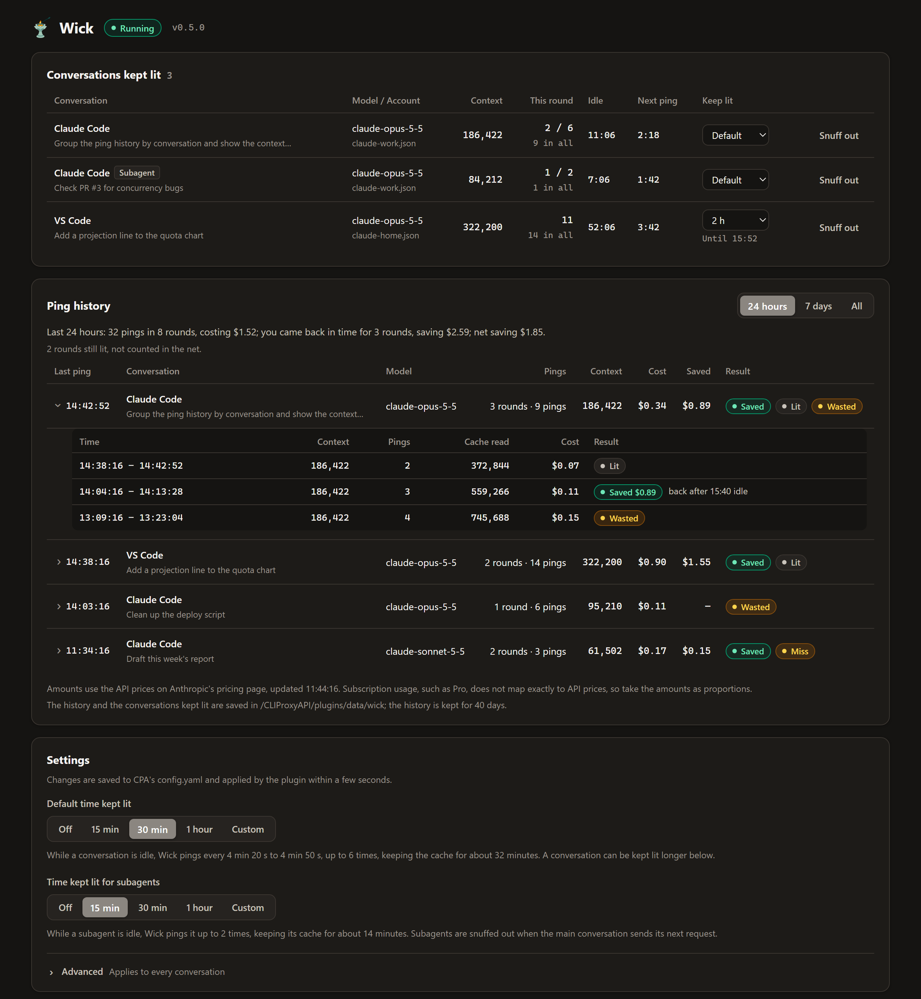

<p align="center"></p>

# Wick

[中文](./README.md)

> The Chinese name, 挑灯 (tiǎo dēng), means trimming the wick of an oil lamp, as in Xin Qiji's line "drunk, I trim the lamp to look at my sword". When a lamp has burned for a while and the flame grows dim, a light touch to the wick with a hairpin makes it bright again. Wick makes the same small move: when a conversation is idle and its cache is about to expire, it sends the last request once more and the cache stays alive. It belongs to the same series of lamps as [Lamplighter](https://github.com/PosvdM/cpa-plugin-lamplighter): the lamplighter lights the next quota window on time, and Wick watches over the conversation in use so that its lamp does not go out.

Wick is a native plugin for [CLIProxyAPI](https://github.com/router-for-me/CLIProxyAPI) (CPA). When Claude Code uses a Claude subscription account through CPA, Wick reads the 5-minute prompt cache on a schedule while a conversation is idle, so the next message still hits the existing cache. Each read is called a ping; stopping the pings is called snuffing out.



## Features

- **Keeps the cache**: once a conversation is idle, Wick pings every 4 min 20 s to 4 min 50 s, up to 6 times by default, keeping the cache for about 32 minutes. The default can be 15 min, 30 min, 1 hour or a custom count; subagents have their own setting, 15 min by default, which can also be off; one conversation can be kept lit for 1 to 24 hours.
- **Leaves the conversation alone**: a ping resends the conversation's last request unchanged and disconnects at the first event. The result never reaches Claude Code, and the conversation context stays the same.
- **Snuffs out by itself**: pings stop at the count or time limit, when a ping fails, or when the cache has already expired, so cache writes are not paid for again and again. When a conversation changes its tools, system prompt or model midway, its old cache can no longer be used, and the old pings stop.
- **Counts the cost**: at the API prices on Anthropic's pricing page, Wick works out what each round of pings cost and the cache write saved when you came back in time. Prices are updated daily, so new models are priced without a plugin update.
- **Management page**: in the CPA Management Center, see the conversations kept lit with their context size, pings this round and countdowns, browse the ping history and its cost by conversation and round, and change the settings.
- **Survives restarts**: the conversations kept lit are saved to disk and continue on schedule after CPA restarts or reloads the plugin.

## Purpose

Claude's prompt cache has two lifetimes: a 5-minute write costs 1.25× the input price and a 1-hour write costs 2×; a cache read costs 0.1×. Every read restarts the cache's timer. Native Claude Code uses the 5-minute cache by default, so after more than 5 minutes away, the next message writes the whole context again at 1.25×. With a context of a few hundred thousand tokens, that one rewrite uses a noticeable share of the quota.

Wick keeps normal writes at the 5-minute price and reads the cache only while a conversation is idle. Ping reads also count against the subscription quota: each ping reads the whole context at 0.1×, so if you come back within one or two ping intervals, the savings are small.

## How it works

- Wick records the last request of each conversation. Counting from the start of that request, it picks a random moment between `interval_min` and `interval_max` seconds and sends the same request again unchanged, disconnecting as soon as the first event, `message_start`, arrives, as if Esc were pressed right after sending. By `message_start` the cache has been read and its lifetime restarted; the upstream may generate a few tokens before the disconnect.
- A ping goes through CPA's model executor with the original account and request headers, so it hits the same cache as the original request.
- A new request in the conversation restarts the timer from that request and starts a new round: the count of the round restarts and a time set for the conversation returns to the default. Each round is limited to `max_pings` pings, or `subagent_max_pings` for subagents.
- Wick snuffs out a conversation when the round reaches its limit or the time set for the conversation, when a ping fails, when a ping writes to the cache (the cache had expired or the request differs, so further pings cannot hit it), when the original request fails, or when the plugin is disabled. Requests interrupted with Esc keep being pinged.
- When a conversation loads new tools midway (such as MCP servers or deferred tools), or changes its system prompt or model, Wick sees its requests as a new conversation. The cache is matched piece by piece from the tools on, so the old conversation's cache can no longer be read. When the messages of the new request continue those of the old conversation, Wick snuffs out the old one.
- Only native Claude Code streaming requests are handled. These requests are not pinged: requests that use the 1-hour cache; and requests with a body smaller than `min_body_kb`, such as title generation.
- Within one session, the main conversation and each subagent are pinged separately; a request with an agent ID counts as a subagent. When the main conversation sends its next request, subagents that started while it was waiting are treated as finished and snuffed out, so a subagent is pinged only when it has been idle longer than the shortest interval and the main conversation has not continued.
- After CPA restarts or reloads the plugin, conversations whose cache has not expired continue on their original schedule, keeping their ping counts and the times set for them; conversations whose cache has expired are not restored.

## Cost and savings

The pings after a request, up to the conversation's next request, make up a round. Each round ends with one of these results:

- **Saved**: you came back more than 5 minutes after the previous request, when the cache would have expired without pings, and less than 5 minutes after the last successful ping, while the cache was alive. The amount saved is the context priced at the difference between the 5-minute write price and the read price.
- **Wasted**: you did not come back within 5 minutes of the last successful ping; or you came back less than 5 minutes after the previous request, when the cache was alive without pings. A conversation that changed its tools, system prompt or model midway is also wasted.
- **Lit**: the last successful ping was less than 5 minutes ago, and there is no result yet.
- **Miss** and **Failed**: the round's last ping wrote to the cache or failed.

A ping costs its cache reads, cache writes and uncached input tokens at API prices; output tokens are not counted. At Claude Opus 5.5 prices, the write saved in one round equals about 24 pings, and a round has at most 6 pings by default, so whether Wick saves or costs mostly depends on whether you come back while the cache is kept.

Prices come from [Anthropic's pricing page](https://platform.claude.com/docs/en/about-claude/pricing). The plugin fetches them when it loads and daily after that, and keeps the last prices when a fetch fails; models missing from the page get no amounts. Amounts are calculated at the prices current when the history is viewed, so past rounds follow price changes. Subscription usage, such as Pro, does not map exactly to API prices, so take the amounts as proportions.

## Requirements

- CPA v8.0.39 or later with plugins enabled (`plugins.enabled: true`).
- Native Claude Code using a Claude subscription account through CPA. Requests from other clients (pi, Cherry Studio and so on) are ignored.

## Installation

1. Download the zip for the system CPA runs on from [Releases](https://github.com/PosvdM/cpa-plugin-wick/releases), or build it as described in the [architecture document](./docs/architecture_EN.md#build).
2. Put the library (`wick-v<version>.so` on Linux) in the `<os>/<arch>/` subdirectory of the CPA plugin directory, for example `plugins/linux/arm64/`. With Docker, the plugin directory is the host directory mounted at `/CLIProxyAPI/plugins` in the container.
3. Enable the plugin in CPA's `config.yaml`:

   ```yaml
   plugins:
     enabled: true
     configs:
       wick:
         enabled: true
   ```

CPA loads the plugin when it detects the config change; no restart is needed.

## Configuration

Settings live under `plugins.configs.wick` in `config.yaml` and take effect when saved. They can also be changed on the [management page](#management-page).

| Key | Default | Description |
| --- | --- | --- |
| `interval_min` | `260` | Shortest interval between pings in seconds |
| `interval_max` | `290` | Longest interval between pings in seconds, at most `299` |
| `max_pings` | `6` | Pings per round of idle time; `0` turns Wick off, subagents included |
| `subagent_max_pings` | `2` | Pings per round of idle time for subagents; `0` leaves subagents out |
| `min_body_kb` | `64` | Skip requests whose body is smaller than this many KiB |
| `history_retention_days` | `40` | Days of ping history to keep, `1` to `3650` |
| `data_dir` | empty | Data directory. Empty means `<plugins.dir>/data/wick`; a relative path is relative to the CPA working directory |

Once a conversation is idle, the cache lasts about `max_pings` × the average interval + 5 minutes, about 32 minutes with the defaults. The cache lifetime counts from when Anthropic receives the request, network latency included, so leave a margin between `interval_max` and 300 seconds. With an invalid config the plugin uses the defaults and writes a warning to the CPA log.

## Management page

Open **Wick** from the plugin menu of the CPA Management Center. The page uses the management key the Management Center remembered at sign-in, or asks for one; the theme and language follow the Management Center.

- **Conversations kept lit**: each conversation shows its client (Claude Code, Claude Desktop, VS Code and so on, taken from the request's User-Agent) and its first prompt, with subagents tagged Subagent; hovering shows the full first prompt, the project directory and the session ID. **Context** is the input tokens of the last ping; **This round** gives the pings since the last request and the conversation's limit, with the conversation's total in the ping history below it, which carries on when a conversation is snuffed out and seen again. The other columns show the model and account, the idle time and a countdown to the next ping. **Keep lit** offers Default, 1, 2, 4 or 8 hours, or a custom number of hours, counted from when it is set; below it the page shows until when. **Snuff out** stops pinging that conversation until it receives its next request.
- **Ping history**: switches between 24 hours, 7 days and All. The summary gives the pings and rounds in that range, their cost, the rounds you came back in time for and the amount saved, and the net saving or cost; rounds still lit count in the cost but not in the net. Each conversation takes one row: the time of its last ping, its rounds and pings, the context of its last ping, the cost, the amount saved, and the rounds by result. Clicking a row shows each round's time, context, pings, cache read, cost and result, with the idle time for rounds you came back to. The list starts with 20 conversations and can be expanded. History from before v0.5.0 did not record when you came back, so its rounds are shown without amounts.
- **Settings**: **Default time kept lit** offers Off, 15 min, 30 min, 1 hour or Custom, which set `max_pings` to `0`, `2`, `6`, `12` or the number entered; below it the page shows the estimated cache lifetime for the current intervals. **Time kept lit for subagents** has the same choices for `subagent_max_pings`. **Advanced** applies to every conversation and changes `interval_min`, `interval_max`, `min_body_kb` and `history_retention_days`. Changes are saved to `config.yaml` and applied by the plugin within a few seconds.

The first prompt is the text the user typed in the first user message of the conversation, leaving out the system reminders and local command output that Claude Code adds; a conversation that starts with a slash command shows the command and its arguments.

## Data directory

The data directory is `<plugins.dir>/data/wick` by default, inside the mounted plugin directory with Docker. Files have mode `0600`, readable only by the user running CPA.

| Path | Content |
| --- | --- |
| `history/<UTC date>.jsonl` | Ping history, one line per ping: time, the first 8 characters of the session ID and conversation key, model, client, project directory, the first 80 characters of the first prompt, cache tokens and result. Coming back to a conversation after pings adds a line with whether it saved a write, the idle time and the pings of the round. Files older than `history_retention_days` days are deleted |
| `conversations/` | The conversations kept lit: the last request, the schedule and the ping counts of each. A conversation's files are deleted when it is snuffed out |
| `prices.json` | The API prices last fetched and when |

## Logs and API

Each ping writes one line to the CPA log with the first 8 characters of the session ID and conversation key, the model, the ping number within the round, and the cache tokens read and written, for example:

```text
wick: ping session=1a2b3c4d key=5e6f7a8b ping=3 cache_read=322200 cache_creation=0 input=3 output=1 model=claude-opus-5-5
```

`output` is the count in `message_start` and leaves out tokens generated before the disconnect. Coming back to a conversation after pings, snuffing out a conversation whose tools changed, and a failed price update each write a line too.

The routes the management page uses can also be called directly; all of them require the CPA management key. `GET /v0/management/wick/status` returns the conversations kept lit and `GET /v0/management/wick/history` returns the ping history summed by conversation; parameters are in the [architecture document](./docs/architecture_EN.md#management-api-and-page):

```bash
curl -H "Authorization: Bearer <management key>" http://127.0.0.1:8317/v0/management/wick/status
```

## Security and risks

- The last request of each conversation kept lit contains the whole conversation. It is kept in memory and in `conversations/` in the data directory, and deleted when the conversation is snuffed out; the ping history keeps the first 80 characters of the first prompt. The key the client uses for CPA (`Authorization`, `X-Api-Key`) is not saved. Conversation content is never written to the logs.
- A ping is identical to the original request and the intervals are random, but regularly resending the same request and cancelling it may still be noticed by the provider. Using a subscription account through CPA carries account risk in itself; judge for yourself.
- When a ping fails (for example, it is rate limited), CPA puts the account into cooldown as it does for any request, and your next request is rejected until the cooldown ends.
- The plugin fetches the pricing page from `platform.claude.com` once a day; the request carries no account or conversation data.

## Development

Plugin structure, the CPA interface, building and testing are described in the [architecture document](./docs/architecture_EN.md).

## License

[AGPL-3.0-or-later](./LICENSE). If you distribute a modified version, or offer a modified version to others over a network, you must publish its source code under the same license.
